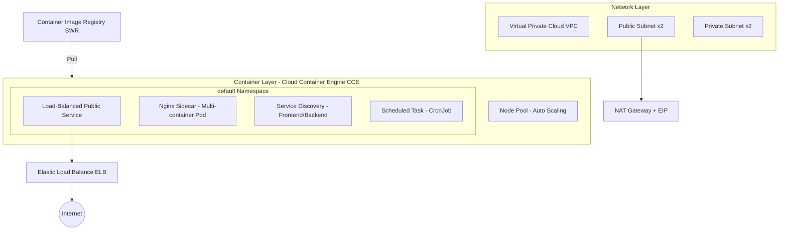

# Container Patterns Catalog (Huawei Cloud Edition)


> This repository is a Huawei Cloud best-practices catalog of container design patterns, providing a set of deployable container pattern reference implementations built on Cloud Container Engine (CCE). Architecture-equivalent replication, not code-level porting.

## 1. Overview

This catalog collects and implements the most commonly used design patterns for deploying container workloads on Huawei Cloud, covering typical scenarios such as load balancing, sidecar, service discovery, and scheduled tasks. Each pattern provides a deployable reference implementation (Terraform infrastructure + Kubernetes manifests + sample application), helping architects and platform engineering teams reuse proven container architectures in a cloud-native way.

## 2. Table of Contents

- [1. Overview](#1-overview)
- [2. Table of Contents](#2-table-of-contents)
- [3. Architecture Diagram](#3-architecture-diagram)
- [4. Highlights](#4-highlights)
- [5. Cloud Services](#5-cloud-services)
- [6. Prerequisites](#6-prerequisites)
- [7. Quick Start](#7-quick-start)
- [8. Step-by-Step Deployment](#8-step-by-step-deployment)
- [9. Usage and Verification](#9-usage-and-verification)
- [10. Cleanup](#10-cleanup)
- [11. Detailed Description](#11-detailed-description)
- [12. Dependencies and Acknowledgments](#12-dependencies-and-acknowledgments)
- [13. FAQ / Troubleshooting](#13-faq--troubleshooting)
- [14. Contributing](#14-contributing)
- [15. License](#15-license)
- [16. Submitter](#16-Submitter)
- [17. Pattern Index](#17-pattern-index)

## 3. Architecture Diagram



For architecture and component details, see [`docs/architecture.md`](docs/architecture.md).

## 4. Highlights

- **Cloud-Native Foundation**: Built entirely on Huawei Cloud native products (CCE / SWR / ELB / VPC), with no legacy cloud dependencies.
- **Patterns as Code**: Each pattern provides a complete reference implementation — Terraform manages infrastructure, Kubernetes manifests manage workloads.
- **Zero Credential on Disk**: Credentials are injected only from environment variables; deliverables use placeholders exclusively.
- **Elasticity-First**: Node pools support auto-scaling; runtime node count changes are not reverted (see `infra/core/main.tf`).
- **Verifiable Scope**: Delivers a structured framework + 4 main-category reference implementations + full service mapping, ensuring usability and extensibility.

## 5. Cloud Services

| Service | Purpose |
|---------|---------|
| Cloud Container Engine (CCE) | Container cluster and node pools |
| Software Repository for Containers (SWR) | Image storage |
| Elastic Load Balance (ELB) | Public load balancing |
| Virtual Private Cloud (VPC) / Subnets | Networking |
| NAT Gateway + EIP | Node egress |

> **Cost Reminder**: CCE clusters, node pools, ELB instances, and NAT gateways incur charges. Run `terraform plan` before `apply` to review billable resources. Default node flavor `s6.large.2` in `cn-north-4` — verify pricing before deployment.
> **Cleanup Hint**: Run `terraform destroy` after verification to avoid ongoing charges (see [Section 10](#10-cleanup)).

## 6. Prerequisites

- A Huawei Cloud account with enterprise real-name verification completed.
- CLI tools: `terraform` >= 1.5, `kubectl`, `docker`.
- Target region (default `cn-north-4`) must have node flavor `s6.large.2` available for sale.
- Access credentials injected from environment variables `AK` / `SK` — never hardcode in files.

## 7. Quick Start

```shell
# 1. Deploy core infrastructure
cd infra/core && terraform init && terraform apply --auto-approve

# 2. Get cluster access configuration
hcloud cce kubeconfig get --cluster <cce_cluster_name> --file ./kubeconfig.yaml
export KUBECONFIG=$PWD/kubeconfig.yaml

# 3. Deploy the load-balanced public service
kubectl apply -f ../patterns/load-balanced-public-service/k8s/deployment.yaml
```

## 8. Step-by-Step Deployment

For complete step-by-step instructions (including image build and push, per-pattern deployment, verification, and cleanup), see [`docs/deployment-guide.md`](docs/deployment-guide.md).

## 9. Usage and Verification

```shell
# View workloads
kubectl get pods,svc,cronjob -n default

# Load-balanced public service: get ELB public IP and access it
kubectl get svc web-frontend -n default \
  -o jsonpath='{.status.loadBalancer.ingress[0].ip}'
curl http://<above_ip>/

# Service discovery: confirm frontend successfully reaches backend
kubectl logs deploy/frontend -n default --tail=20

# Scheduled task: observe the most recent scheduled Job
kubectl get jobs -n default
```

## 10. Cleanup

```shell
kubectl delete -f infra/patterns/load-balanced-public-service/k8s/deployment.yaml
kubectl delete -f infra/patterns/nginx-sidecar-reverse-proxy/k8s/deployment.yaml
kubectl delete -f infra/patterns/service-discovery/k8s/deployment.yaml
kubectl delete -f infra/patterns/scheduled-cron-job/k8s/cronjob.yaml
cd infra/core && terraform destroy --auto-approve
```

## 11. Detailed Description

- Architecture and components: [`docs/architecture.md`](docs/architecture.md)
- Deployment and verification: [`docs/deployment-guide.md`](docs/deployment-guide.md)
- Constraint self-check: [`docs/response-constraints.md`](docs/response-constraints.md)
- Service mapping: [`others/service-mapping.md`](others/service-mapping.md)
- Architecture adaptation and degradation decisions: [`others/architecture-adaptation.md`](others/architecture-adaptation.md)

**CCE Workload Split Delivery**: The current version of the Huawei Cloud Provider does not include a `huaweicloud_cce_workload` resource. Therefore, clusters and node pools are managed by Terraform, while Deployments / Services / CronJobs are delivered as `kubectl` manifests (see `infra/patterns/*/k8s/`).

## 12. Dependencies and Acknowledgments

- Container orchestration: Huawei Cloud Container Engine (CCE)
- Image registry: Huawei Cloud Software Repository for Containers (SWR)
- Load balancing: Huawei Cloud Elastic Load Balance (ELB)
- Infrastructure as Code: Terraform + huaweicloud Provider
- Acknowledgments: The pattern design and community contributors of the original container patterns catalog; this practice replicates their pattern concepts on Huawei Cloud as an architecture-equivalent adaptation.

## 13. FAQ / Troubleshooting

- **Q: Services don't come up after `terraform apply`?**
  A: Terraform does not wait for workload health. Check whether the node pool is ready, run `kubectl get pods` to inspect status, and verify that images have been pushed to SWR.

- **Q: ELB public IP is empty?**
  A: ELB auto-creation takes a few minutes; wait and re-run `kubectl get svc web-frontend`. If it remains empty for a long time, check whether the node security group allows inbound traffic.

- **Q: Service discovery resolution fails?**
  A: Confirm that the frontend and backend are in the same namespace, and that the backend Service name matches the DNS name in the frontend's `NODEJS_URL`.

- **Q: Node flavor `s6.large.2` is not available in the target region?**
  A: After switching regions, re-verify flavor availability and update `node_flavor` in `infra/core/variables.tf`.

## 14. Contributing

Contributions of new pattern reference implementations are welcome. New patterns should follow the repository structure: provide `main.tf` (image registry, etc.) and `k8s/` manifests under `infra/patterns/<pattern_name>/`, and sample application source code in `src/sample-app/`. Also update the pattern index in this README and `others/service-mapping.md`. See [`CONTRIBUTING`](CONTRIBUTING.md) for general guidelines.

## 15. License


This project is open-sourced under the MIT-0 license.

## 16. Submitter

**Submitter**: zhangcheng123321

## 17. Pattern Index

| Pattern | Path | Equivalent Original Pattern Category |
|---------|------|--------------------------------------|
| Load-Balanced Public Service | `infra/patterns/load-balanced-public-service/` | Expose multi-replica web service externally |
| Nginx Reverse Proxy Sidecar | `infra/patterns/nginx-sidecar-reverse-proxy/` | Single-task multi-container collaboration |
| Service Discovery | `infra/patterns/service-discovery/` | Inter-service name-based addressing |
| Scheduled Task | `infra/patterns/scheduled-cron-job/` | Schedule one-off work on a recurring basis |

> Additional patterns can be extended category by category following the mapping rules in [`others/service-mapping.md`](others/service-mapping.md).
