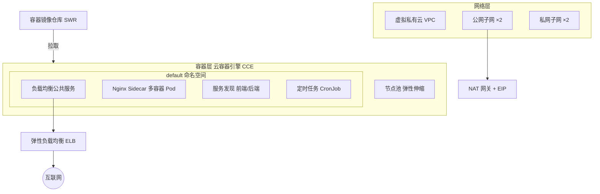

# 容器模式目录（华为云版）


> 本仓库是容器设计模式的华为云最佳实践目录，基于云容器引擎 CCE 提供一组可落地的容器模式参考实现。架构等价复刻，非代码平移。

## 一、概述

本目录汇总并实现了在华为云上落地容器工作负载时最常用的设计模式，覆盖负载均衡、Sidecar、服务发现、定时任务等典型场景。每个模式均提供可部署的参考实现（Terraform 底座 + Kubernetes 清单 + 示例应用），帮助架构师与平台工程团队以云原生方式复用经过验证的容器架构。

## 二、目录

- [一、概述](#一概述)
- [二、目录](#二目录)
- [三、架构图](#三架构图)
- [四、方案亮点](#四方案亮点)
- [五、涉及云服务](#五涉及云服务)
- [六、前置条件](#六前置条件)
- [七、快速开始](#七快速开始)
- [八、分步部署](#八分步部署)
- [九、使用方法与验证](#九使用方法与验证)
- [十、清理资源](#十清理资源)
- [十一、详细说明](#十一详细说明)
- [十二、依赖与致谢](#十二依赖与致谢)
- [十三、FAQ / 故障排除](#十三faq--故障排除)
- [十四、贡献指南](#十四贡献指南)
- [十五、许可证](#十五许可证)
- [十六、提交者](#十六提交者)
- [十七、模式索引](#十七模式索引)

## 三、架构图



架构与组件说明详见 [`docs/architecture.md`](docs/architecture.md)。

## 四、方案亮点

- **云原生底座**：全部基于华为云原生产品（CCE / SWR / ELB / VPC），无原云依赖残留。
- **模式即代码**：每个模式提供完整参考实现，Terraform 管底座、Kubernetes 清单管工作负载。
- **零密钥落盘**：凭据仅从环境变量注入，交付物中一律以占位符表示。
- **弹性优先**：节点池支持弹性伸缩，运行期节点数改写不回滚（见 `infra/core/main.tf`）。
- **可验证范围**：交付结构化框架 + 4 个主类别参考实现 + 全量服务映射，保证可直接使用且可扩展。

## 五、涉及云服务

| 服务 | 用途 |
|------|------|
| 云容器引擎 CCE | 容器集群与节点池 |
| 容器镜像仓库 SWR | 镜像存储 |
| 弹性负载均衡 ELB | 公网负载均衡 |
| 虚拟私有云 VPC / 子网 | 网络 |
| NAT 网关 + EIP | 节点出网 |

## 六、前置条件

- 华为云账号并完成企业实名认证。
- 命令行工具：`terraform` >= 1.5、`kubectl`、`docker`。
- 目标区域（默认 `cn-north-4`）节点规格 `s6.large.2` 可售。
- 访问凭据从环境变量 `访问凭据` / `访问凭据` 注入，禁止写入文件。

## 七、快速开始

```shell
# 1. 部署核心基础设施
cd infra/core && terraform init && terraform apply --auto-approve

# 2. 获取集群访问配置
hcloud cce kubeconfig get --cluster <cce_cluster_name> --file ./kubeconfig.yaml
export KUBECONFIG=$PWD/kubeconfig.yaml

# 3. 构建一个并部署负载均衡公共服务
kubectl apply -f ../patterns/load-balanced-public-service/k8s/deployment.yaml
```

## 八、分步部署

完整分步说明（含镜像构建推送、各模式部署、验证、清理）见 [`docs/deployment-guide.md`](docs/deployment-guide.md)。

## 九、使用方法与验证

```shell
# 查看工作负载
kubectl get pods,svc,cronjob -n default

# 负载均衡公共服务：获取 ELB 公网地址并访问
kubectl get svc web-frontend -n default \
  -o jsonpath='{.status.loadBalancer.ingress[0].ip}'
curl http://<上述IP>/

# 服务发现：确认前端成功访问后端
kubectl logs deploy/frontend -n default --tail=20

# 定时任务：观察最近一次调度的 Job
kubectl get jobs -n default
```

## 十、清理资源

```shell
kubectl delete -f infra/patterns/load-balanced-public-service/k8s/deployment.yaml
kubectl delete -f infra/patterns/nginx-sidecar-reverse-proxy/k8s/deployment.yaml
kubectl delete -f infra/patterns/service-discovery/k8s/deployment.yaml
kubectl delete -f infra/patterns/scheduled-cron-job/k8s/cronjob.yaml
cd infra/core && terraform destroy --auto-approve
```

## 十一、详细说明

- 架构与组件：[`docs/architecture.md`](docs/architecture.md)
- 部署与验证：[`docs/deployment-guide.md`](docs/deployment-guide.md)
- 约束自检：[`docs/response-constraints.md`](docs/response-constraints.md)
- 服务映射：[`others/service-mapping.md`](others/service-mapping.md)
- 架构适配与降级决策：[`others/architecture-adaptation.md`](others/architecture-adaptation.md)

**CCE 工作负载拆分交付**：华为云 Provider 当前版本无 `huaweicloud_cce_workload` 资源，故集群与节点池由 Terraform 管理，Deployment / Service / CronJob 以 `kubectl` 清单交付（见 `infra/patterns/*/k8s/`）。

## 十二、依赖与致谢

- 容器编排底座：华为云云容器引擎 CCE
- 镜像仓库：华为云容器镜像仓库 SWR
- 负载均衡：华为云弹性负载均衡 ELB
- 基础设施即代码：Terraform + huaweicloud Provider
- 致谢：原容器模式目录的模式设计与社区贡献者；本实践在其模式思想上做华为云等价复刻。

## 十三、FAQ / 故障排除

- **Q：`terraform apply` 后服务起不来？**
  A：Terraform 不等待工作负载健康。请检查节点池是否就绪、`kubectl get pods` 状态与镜像是否已推送至 SWR。

- **Q：ELB 公网地址为空？**
  A：ELB 自动创建需数分钟；等待后重新 `kubectl get svc web-frontend`。如长时间为空，检查节点安全组是否放通入站。

- **Q：服务发现解析失败？**
  A：确认前端与后端在同一命名空间，且后端 Service 名称与前端 `NODEJS_URL` 中的 DNS 名称一致。

- **Q：节点规格 `s6.large.2` 在目标区域不可售？**
  A：切换区域后须重新核验规格可售性，并修改 `infra/core/variables.tf` 中的 `node_flavor`。

## 十四、贡献指南

欢迎补充新模式的参考实现。新增模式请遵循本仓库结构：在 `infra/patterns/<模式名>/` 下提供 `main.tf`（镜像仓库等）与 `k8s/` 清单，并在 `src/sample-app/` 提供示例应用源码；同时更新本 README 的模式索引与 `others/service-mapping.md`。详见 [`CONTRIBUTING`](CONTRIBUTING.md) 通用规范。

## 十五、许可证

本项目基于 MIT-0 许可证开源。

## 十六、提交者

- 提交者：zhangcheng123321

## 十七、模式索引

| 模式 | 路径 | 等价原模式类别 |
|------|------|----------------|
| 负载均衡公共服务 | `infra/patterns/load-balanced-public-service/` | 对外暴露多副本 Web 服务 |
| Nginx 反向代理 Sidecar | `infra/patterns/nginx-sidecar-reverse-proxy/` | 单任务多容器协作 |
| 服务发现 | `infra/patterns/service-discovery/` | 服务间按名称寻址 |
| 定时任务 | `infra/patterns/scheduled-cron-job/` | 按计划调度一次性工作 |

> 其余模式可依据 [`others/service-mapping.md`](others/service-mapping.md) 的映射规则逐类扩展。
