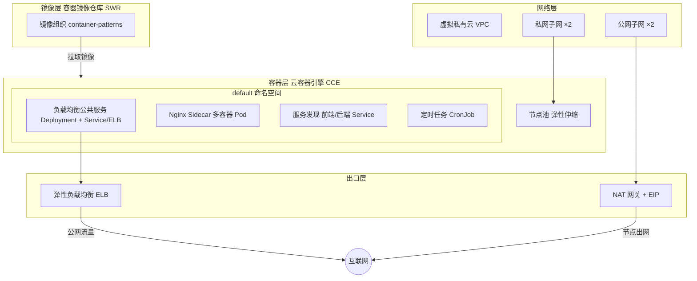

# 华为云架构说明

本仓库是「容器模式目录」的华为云最佳实践版本，提供一组基于云容器引擎（CCE）的容器设计模式参考实现。原模式集以另一云厂商的容器编排服务为底座，本实践将其架构等价复刻到华为云原生服务，使模式在华为云上可直接落地。

## 总体架构

## 参考模式清单（本实践已交付）

1. **负载均衡公共服务**：多副本 Deployment + Service（ELB 自动创建），等价原负载均衡 Web 服务。
2. **Nginx 反向代理 Sidecar**：单 Pod 双容器（nginx + 应用）共享网络命名空间，等价原 Sidecar 模式。
3. **服务发现**：前端/后端两个 Service，经集群内 DNS 互相寻址，等价原服务注册发现能力。
4. **定时任务**：CronJob 按 cron 表达式调度一次性 Pod，等价原计划任务。

## 设计要点

- **工作负载外置**：CCE 集群与节点池由 Terraform 管理；Deployment / Service / CronJob 等 Kubernetes 工作负载以 `kubectl` 清单交付（详见 `infra/patterns/*/k8s/` 与 `src/manifests/`）。这是华为云 Provider 对 CCE 工作负载声明的推荐拆分方式。
- **镜像统一纳管**：所有示例镜像统一推送至 SWR 组织 `container-patterns`，仓库按模式划分。
- **弹性与成本**：节点池初始节点数由弹性伸缩在运行期改写，Terraform 配置 `lifecycle.ignore_changes` 避免回滚（见 `infra/core/main.tf`）。
